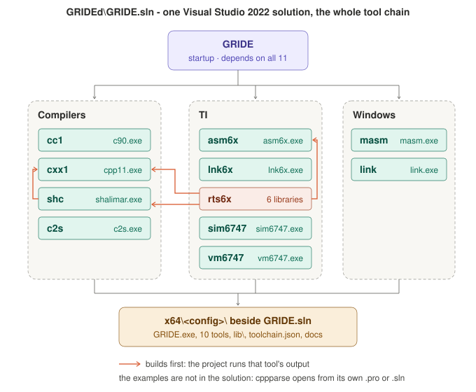

# GRIDE

A C++/CLI IDE in the style of Visual Studio for three languages and four targets:

| Languages | Targets | Tool chain |
|---|---|---|
| C90, C++11, Shalimar | Windows, Linux, macOS, TMS320C6747 | MASM / LINK (Windows) and ASM6x / LNK6x / RTS6747 / VM6747 (DSP) |

It also has C ⇄ Shalimar conversion and read-only reading of Code Composer Studio 7.4 / 5.5 projects and of Visual Studio solutions and projects. What RIDE (the reference editor) does with the tool chain - its names and conventions, its CCS reader, its debuggers, its settings - is ported here, and all of the tool chain's names live in `toolchain.json`, not in the code.

---

## 1. Build it

| Need | Where |
|---|---|
| Visual Studio 2022 (also opens in VS 2026) | Workload **Desktop development with C++** |
| C++/CLI support | Installer > Individual components > **C++/CLI support for v143 build tools** |
| .NET Framework 4.8 targeting pack | Installer > Individual components |

1. Open `GRIDE.sln`. The tool chain's projects are inside this folder, under `toolchain\Compilers`, `toolchain\TI` and `toolchain\Windows` (minimal copies made by `toolchain\copy-toolchain.py`; `toolchain\MANIFEST.md` says what each holds and why), so nothing has to sit beside it.
2. Choose `Release | x64`.
3. Build (F7) and run (F5).

The output is `<platform>\<config>\GRIDE.exe` (`x64\Release\GRIDE.exe`), with `toolchain.json` and `lib\ccs\*.tsv` beside it, and in an x64 build the whole tool chain too - see *The tool chain in the solution* below. **Help > View Help** (F1) opens `GRIDE_Help.html`, the one brief Help the three outlooks share (GRIDEx3's `docs\`, copied to `docs\` beside the exe with the reference pages): GRIDE looks in the help directory named under Tools > Options > Projects, then beside the exe, in `docs` and `help` under it, then in `..\help` and `..\docs`. The Setup's layout is `GRIDE\Black\GRIDE.exe` with `toolchain.json`, the tools, `docs\`, `lib\` and `examples\cppparse` beside it. `docs\` here holds only notes for GRIDEd's developers. Both configurations build with 0 errors and 0 warnings on the v143 toolset; the Help is copied beside the exe by an MSBuild Copy, and no step of the build starts `cmd.exe`.

`GRIDE.sln` holds every project GRIDE is built and shown with; Build Solution builds what the configuration selects:

| Project | Solution folder | Project file | Built in | What it is |
|---|---|---|---|---|
| `GRIDE` | - | `GRIDE\GRIDE.vcxproj` | every configuration | the IDE |
| `cc1` (c90), `cxx1` (cpp11), `shc` (shalimar), `c2s` | Compilers | `toolchain\Compilers\...` | `Debug \| x64`, `Release \| x64` | the C90, C++11 and Shalimar compilers and the C ⇄ Shalimar converter |
| `asm6x`, `lnk6x`, `ar6x`, `rts6x`, `sim6747`, `vm6747` | TI | `toolchain\TI\...` | `Debug \| x64`, `Release \| x64` | the TMS320C6747 assembler, linker, run-time libraries, simulator and emulator, and `ar6x`, the archiver rts6x packs its libraries with (a build tool, built into its own `build\`, not shipped) |
| `masm`, `link`, `gride-dbg`, `grt` | Windows | `toolchain\Windows\...` | `Debug \| x64`, `Release \| x64` | the Windows assembler and linker, GRIDE's Windows debugger, and GRIDE's Windows C runtime (`lib\grt*.lib`) |
| `Setup` | - | `..\installer\windows\Setup.vcxproj` | not with the solution: Build on it, in `Release \| x64` | GRIDE's Windows Setup, `installer\dist\GRIDE-Setup-<ver>.msi`, from the three outlooks' Release builds (GRIDEx3's `README.md`, Installers) |

The examples are not in the solution (taken out on 2026-10-27): cppparse, the example of section 2, opens in GRIDE
itself from its `.pro`, and in Visual Studio from its own `examples\projects\cppparse\cppparse.sln`.

**Opening `GRIDE.sln` in Visual Studio 2026.** Every project targets v143, Visual Studio 2022's toolset, so the solution opens and builds in both. If Visual Studio 2026's *Setup assistant* offers to retarget a project to v145, choose **Ignore all** - nothing is missing (v143 is the *MSVC v143* component), and v145 would stop Visual Studio 2022 building it.

### The tool chain in the solution



The same picture as a PowerPoint slide, with speaker notes: [`docs/solution-dependencies.pptx`](docs/solution-dependencies.pptx).

GRIDE depends on every tool, so building GRIDE (or F5 on it) builds the whole tool chain first. Two of the tools depend on others, because they run what those build (the names are Solution Explorer's, each project file's own: `cc1` builds `c90.exe`, `cxx1` `cpp11.exe`, `shc` `shalimar.exe`, the rest the exe of their name):

```
GRIDE  (the startup project; depends on all eleven tools)
├── cc1        toolchain\Compilers\Compiler-Ci\ide\cc1.vcxproj
├── cxx1       toolchain\Compilers\C++Optimize\ide\cxx1.vcxproj
├── shc        toolchain\Compilers\Compiler-Si\ide\shc.vcxproj
│   └── cxx1           its ShalimarRuntimes step compiles the Shalimar run-time with cpp11.exe
├── c2s        toolchain\Compilers\Converter-C2S\c2s.vcxproj
├── asm6x      toolchain\TI\ASM6x\asm6x.vcxproj
├── lnk6x      toolchain\TI\LNK6x\lnk6x.vcxproj
├── rts6x      toolchain\TI\RTS6x\rts6x.vcxproj  (its steps are MSBuild tasks: toolchain\msbuild\Toolchain.targets)
│   ├── cxx1           compiles the C6000 run-time library
│   ├── asm6x          assembles it, and Shalimar's TMS6747 run-time
│   ├── shc            writes lib\shmrt-tms6747\*.s, which rts6x assembles
│   └── ar6x           packs the libraries (toolchain\TI\RTS6x\tools\ar6x\ar6x.vcxproj, into its own build\)
├── sim6747    toolchain\TI\SIM6747\sim6747.vcxproj
├── vm6747     toolchain\TI\VM6747\vm6747.vcxproj
├── masm       toolchain\Windows\MASM\masm.vcxproj
├── link       toolchain\Windows\LINK\link.vcxproj
├── gride-dbg  toolchain\Windows\DBG\dbg.vcxproj
└── grt        toolchain\Windows\RT\grt.vcxproj  (built by c90, cpp11, masm and link into lib\)
    ├── cc1, cxx1
    └── masm, link

Setup  ..\installer\windows\Setup.vcxproj  (after GRIDE; not built with the solution)
```

Every project builds into the one folder `x64\<config>\` beside `GRIDE.sln` (ar6x, a build tool, into its own `build\`), so a build leaves GRIDE ready to run, each tool where `toolchain.json`'s lookup finds it - beside `GRIDE.exe`:

```
x64\Release\
├── GRIDE.exe, toolchain.json, docs\
├── c90.exe, cpp11.exe, shalimar.exe, c2s.exe
├── asm6x.exe, lnk6x.exe, sim6747.exe, vm6747.exe
├── masm.exe, link.exe
└── lib\
    ├── ccs\                       CCS 7.4 / 5.5 option tables (GRIDE)
    ├── shmrt-x86_64-windows*.lib  the Shalimar run-time (shalimar's build step)
    ├── shmrt-tms6747*\            its TMS6747 assembly (shalimar's build step)
    └── rts6x-tms6747\             rts6x, rts6xd, printf6x, printf6xd, shmrt6x, shmrt6xd (rts6x)
```

The tools build for x64 only; the x86 configurations build GRIDE alone. The copies under `toolchain\` hold no solution of their own; `GRIDE.sln` builds them. `Debug | x64` builds the whole solution too, into `x64\Debug` (link's `image.cpp` starts two locals at 0, so its `/WX` no longer stops on C4701); `cpp11` warns C4702 (`A64Peep.cpp`), the tool's own, left as it is.

## 2. Try it

1. Run GRIDE.
2. Go to **File > Open > Project / Workspace** and pick `..\examples\projects\cppparse\cppparse.pro` (installed: `examples\projects\cppparse\cppparse.pro` beside `GRIDE.exe`).
3. You get **cppparse**, the C++ project reader and compiler of the cpp repo: 39 sources and 36 headers in eight folders, a GRIDE project in the one `.pro` format the three outlooks share (section 3) - its compiler `cpp11`, its include directories (`"include"`) and the program's arguments (`"build"`'s `"args"`). The same folder holds `cppparse.sln`, which opens here too, read-only, as the Visual Studio project it is.
4. Press **F7** to build - Release or Debug, nothing to set up first. Every source goes to GRIDE's own `cpp11` (to assembly), then `masm` and `link`; cpp11's headers and library cover what cppparse uses. The link takes GRIDE's own C runtime (`lib\grtstart.lib` ... `grtwin.lib` and GRIDE's `kernel32.lib`, by their paths): no Visual Studio, no Windows SDK, no `vcvars64.bat`, no `cmd.exe`. Where Visual Studio is installed, Tools > Options > Projects > GRIDE Paths > Windows C runtime can choose Microsoft's CRT instead.
   The files compile and assemble side by side, one per processor (**Tools > Options > Environment > General > Files compiled at once**: `0`, the default, one per processor; `1`, one at a time, as before 2026-10-26; `buildJobs` in `settings.json`), the largest first; the Output pane and the Error List show each file's lines in the project's order, as one file after another would, and the first file that fails stops the rest. On the 12-processor machine this was measured on, cppparse's Release Rebuild takes 50 s instead of 190 s one at a time. A GRIDE started from `x64\Debug` runs the Debug-built compilers beside it, about 14 times slower than the Release ones (cpp11 on `Html.cpp`: 131 s against 9 s): build and run `x64\Release` (or the installed GRIDE) for real work.
5. The program's arguments are set too: `--health` and `.` (**Project > Properties > Program arguments**, one per line), which make cppparse check its own sources. Press **Ctrl+F5** to run the startup project's program: its health report, then `[program returned N]`. It runs inside the Output pane, as RIDE runs one: its lines arrive as it writes them, the line under the output is its input (Enter sends it), **Debug > Stop Program** (or Ctrl+Break) kills it and everything it started.
6. Press **F5** to debug. A Debug build for the **TMS320C6747** is debugged for real, as RIDE debugs one: on `sim6747 --run --debug` with the linked `.out` when it is this build's and carries a line table (`c90 -g` / `cpp11 -g` / `shalimar -g` write cl6x's `.dwpsn`), else on `vm6747 --debug` with the assembly - the Output pane (Debug) says which and why. It runs to the first breakpoint (`stopped at stepped.c:14 in main`), **F10 / F11 / Shift+F11** step, the Call Stack, Registers (`A0`..`B15`, `pc`), Watch (`$A4`, an expression) and Memory panes read the engine, and the program's own `printf` lines come through as the program's output; the end is `the program ran to the end and returned N`. A **Windows** Debug build (CodeView through clang and `link.exe /DEBUG`, or `cl`'s PDB) is debugged with `cdb` on a pseudo-console, as White does it (`cdb -y <dir> <exe>`; locals with their types and addresses from `dv /t /V`, the stack from `k`, `??` for a watch, `r`, `db`); without `cdb`, a debugger named for the role `fallbackDebugger` in `toolchain.json` (lldb) stands in when it is found. A **Shalimar** Debug build stops itself where no debugger reads it (RIDE's session): the program is started with `SHM_DEBUG=1` - on the C6747 its `.out` under `sim6747 --run` - and talks on its standard error (`#file`, `#ready`, `#stop unit line depth`, `#exit status`); a breakpoint, F10, F11 and Shift+F11 work by statement, the Call Stack shows one frame that says how deep the program is, and Locals says *a Shalimar program says where it is, not what is in it*. Where nothing can debug the build (a Release build, a target without a line table, no `vm6747` for a C program) the Output pane says why in RIDE's words and the placeholder (a simulation) stands in. The panes show what RIDE's Debug tab shows: **Locals** has the stop line on top (`stopped at stepped.c:14 in main`, and `the variables are main's, at ...` when a frame above is looked at), the variables as `Name | Value | Type | Address` with a value changed since the last stop in red, the engine's reason in brackets when there are none, and White's keys line along the bottom; the line above it sets a variable (`name = value`, Enter; Enter on a row fills it in). **Watch** lists the expressions the engine reads again at every stop and frame change (a refused one in grey), with `add a watch...` as its last row - the line under it adds one, Enter on a watch brings it there to be changed and an empty answer takes it away. **Call Stack** shows the frame looked at in bold; a double-click, **Debug > Up the Stack** and **Down the Stack** (RIDE's Ctrl+Up / Ctrl+Down) look at another frame, and the top frame is the stop again. **Tools > Options > Environment > Keyboard** has the key set: Visual Studio's (F5, F10, F11, Shift+F11, F9, F7, Ctrl+F5) or RIDE's (F8 debugs or carries on, F7 / F6 step over / into, F9 breakpoint, Ctrl+Up / Ctrl+Down the stack, F4 builds, F5 runs, Ctrl+B compiles this file), with your own bindings over either.
   With **gride-dbg** beside GRIDE (GRIDE's own debugger for a Windows Debug build, chosen before `cdb`): **F10 / F11** with nothing debugged build, start and stop at main's first line, as Visual Studio does (F5 runs to a breakpoint or the end); the program's output comes as it prints it, a line it has not finished included (`Enter n: `, its rest joined to it later); a program reading its input gets the line typed under the Output pane while it is debugged; a watch of a name the stop cannot see says `not in scope here`; a Shalimar array shows its elements (`b = {2, 4, 10}`, `A[1][1]`), and cpp11's `vector`, `string` and `initializer_list` what they hold; a one-line function's parameters are read once its prologue has stored them (c90's and shalimar's; cpp11's to come).

## 3. Files GRIDE uses

| File | What it holds | Where |
|---|---|---|
| `*.pro` | One project, in the one format the three outlooks share (White's, RIDE's): `groups` (the folders and their files, relative to the `.pro`; a group may name its own compiler, `{ "files", "toolchain" }`), `include`, `libraries`, `arch`, `toolchain`, `options` (RIDE's Compiler Options), `emulateOnly` and `build` (`target`, the `groups` built, the program's `args`); beside them what only GRIDEd keeps - `configurations`, `excludeFromBuild`, `dependsOn`, `language`, `template`, `targets` - which White writes back as it read them. A `.pro` GRIDEd wrote before (`folders`, `folderToolchains`, `programArgs`) is read and saved in the one format | Project folder |
| `*.grws` | Workspace: list of `.pro` files, CCS projects and Visual Studio projects (with their solution), startup project, active Config/Target, breakpoints; for a CCS or Visual Studio project, what GRIDE keeps for it - its compiler (`toolchain`), a folder's own (`folderToolchains`), the program's arguments (`programArgs`) and `emulateOnly` | Anywhere |
| `settings.json` | IDE settings: tool paths, include/lib folders, command templates, languages, converters, theme, keys, layout, and RIDE's settings.json keys (section 4, RIDE's settings) - GRIDE's one settings file, which Grey and White keep their own keys in too; each outlook writes back the others' as it read them. A `gride.settings.json` from before is taken in the first time, and removed | `%APPDATA%\GRIDE\`, or next to `GRIDE.exe` for a portable install |
| `toolchain.json` | The toolchain: every tool, its names and aliases, where it is found, its argument templates per operation, each debugger's session (how it is driven), the libraries, the Compiler Options rows, the CCS and Visual Studio sections, the C6747 linker command file (see section 4 and `docs\TOOLCHAIN-FORMAT.md`) | Shipped next to `GRIDE.exe`; your overrides in `%APPDATA%\GRIDE\toolchain.json` (portable: `toolchain.user.json` next to the exe); `GRIDE_TOOLCHAIN` names the shipped file outright |
| `lib\ccs\*.tsv` | TI's option definitions for CCS 7.4 (compiler 8.2) and CCS 5.5 (compiler 7.4): the defaults of what a `.cproject` leaves unstored (see section 4, CCS projects) | Shipped next to `GRIDE.exe` |
| `.project`, `.ccsproject`, `.cproject` | A CCS project, read only (never written) | The CCS project folder |
| `.sln`, `.vcxproj`, `.vcxproj.filters`, `.vcproj` | A Visual Studio solution / project, read only (never written); the solution opens as a workspace | Where Visual Studio keeps them |

## 4. Plugging in your real tools

Open **Tools > Options > Toolchains > *target***. Each target has:

- **Tool paths:** C90 / C++11 / Shalimar compilers, assembler, linker, runtime and simulator. A status column shows whether each one is found.
- **Command templates** for each build step. For example:

  ```
  "$(Assembler)" "$(AsmFile)" --output_file="$(ObjFile)"
  "$(Linker)" $(Objects) "$(LinkerCmd)" -o "$(Output)" $(LibDirFlags) $(LibFlags)
  ```

- **Flag spellings** (`-I`, `-D`, `/LIBPATH:` …) and file extensions.
- **Tool environment (optional):** a setup script such as `vcvars64.bat` (the tools then run through `cmd.exe` after it), extra environment variables (`NAME=value`, one per line), the code page of the tool output (0 = the OEM code page) and an extra error pattern (a regular expression with the groups `file`, `line`, `col`, `sev`, `code`, `msg`). Without a setup script the tools are started directly, so `cmd.exe` is not needed.

The build pipeline is `source → (compile) → .s → (assemble) → .obj → (link) → program`, with RIDE's rules:

- **A compiler per folder.** Project > Properties names the project's compiler and a folder's own (`auto`, `c90`, `cpp11`, `shalimar`, `cl`); a folder naming a compiler that does not take a file refuses the build with RIDE's sentence. The Output pane prints `$ <folder> (<compiler>)` as each part starts, `$ linking with <linker>` and `[built <program>]`.
- **A Shalimar program is one compilation**: every `.shl` of the build goes to `shalimar` in one command and one assembly file comes out, named after the program (Compile File takes the one file alone).
- **A Debug build for Windows carries CodeView**: the compilers write the GNU spelling (`-masm=gnu`), `clang` assembles it and Microsoft's `link.exe /DEBUG` writes the PDB the debugger reads; `masm` and RIDE's `link` make a Release build. When `clang` or `link.exe` is not there, the build goes on with `masm` / `link` and says so (the debugger will see no lines). The compilers are also given RIDE's environment (`C90_AS`, `C90_LD`, ... naming the project's assembler and linker, empty for a CodeView build).
- **The C6747 program**: `asm6x` and `lnk6x` against RTS6x - the configuration's library (`rts6xd.lib` for Debug, `rts6x.lib` for Release) for every alias the project names (`libc.a`, `rts6740*`, `rts6747.lib`, `rts6x.lib`), the Shalimar runtime's library before it for a Shalimar program, the project's `c6747.cmd` where it is on disk, else RIDE's own linker command file written into the object folder; `$ lnk6x N objects, ... -o prog.out` and `[linked ...]`. A project marked *Emulate only* (Project > Properties) stops at the assembly, which Run hands to `vm6747`.
- **Visual Studio's tools without cmd.exe**: `cl`, `ml64`, `link.exe` and `clang` are found through `vswhere` and the installation's layout (`toolchain.json`'s `visualStudio` section: the newest compiler version, or the one `msvcVersion` pins), and every tool run on the Windows target gets `INCLUDE`, `LIB` and `PATH` from it - so RIDE's `link` finds the CRT, and a setup script is only needed when you want one.
- **A part given to `cl`** (the project's compiler, or a folder's): `cl` writes the object itself (`[cl]  main.cpp  ->  .gride/obj/Release/main.obj`, nothing assembled after it), with its compiler PDB in the object folder; a Visual Studio project's own cl settings go with it (below); no installation header directory of RIDE's - however it came, a shared include or the target's - is put in front of Visual Studio's headers (the Output pane says when one is left out); and Microsoft's `link.exe` links the objects in either configuration, taking the C runtime the objects name (`/MT`, `/MTd`, `/MD` ...) when every one is cl's. Every progress line names the program that runs and the file it writes: `cl.exe` named in the C++11 slot prints `[cl] ... .obj`, not `[cpp11] ... .s`.
- **The native-tools question**: when the project's own `masm`/`link` (or `lnk6x`) fail and the output names no fault in the source, GRIDE asks *The project's own masm and link did not build it. Use Visual Studio's ml64 and link.exe for this build instead?* and, on yes, builds again with them (`[built with ..., not GRIDE's ...]`). Tools > Options > General turns the question off.
- **Refusals**: a target that only reaches assembly on this machine (Linux, macOS) compiles to `.s` and says `x86_64-linux only reaches -S here - switch to x86_64-windows to run it`; a program folder that cannot be written to is refused before any compiler runs.

No code change is needed when the real tools arrive.

### The toolchain file (`toolchain.json`)

GRIDE keeps no tool name, library name or argument convention in its code. All of it is in
`toolchain.json` beside `GRIDE.exe` (the shipped defaults: RIDE's `c90`, `cpp11`, `shalimar`, `masm`,
`link`, `clang` + Microsoft's `link.exe` for a Debug build, `asm6x`, `lnk6x`, `sim6747`, `vm6747`,
`c2s`, `cdb`/`gdb`/`lldb`; RTS6x, printf6x, the Shalimar runtime, the host CRT; the C6747 linker
command file), with your overrides in `%APPDATA%\GRIDE\toolchain.json` (portable install:
`toolchain.user.json` beside the exe). Your file wins field by field; what it does not name keeps the
shipped value; fields GRIDE does not know are kept. Every tool has an id, a role, its languages and
targets, its program name and aliases (the brief's `cc1.exe`, `shc.exe`, `ASM6x.exe` ... are aliases of
RIDE's names), where it is looked for (environment variable, the installation, PATH), its version
query, output encoding, diagnostics shape, the environment it reads, its target / include / define /
configuration flags, and one argument template per operation (`compileToAssembly`, `assemble`,
`link`, `simulate`, `emulate`, `debug` ...) with every argument described; `cl` also carries
`projectSettings`, the switches it takes for a Visual Studio project's own ClCompile settings, and the
`visualStudio` section an optional `msvcVersion` pinning the compiler version. Edit it under **Tools >
Options > Toolchains > Definitions (toolchain.json)** - program names, aliases, templates, flags,
libraries, with "Restore shipped defaults" per tool and per library - or by hand. A malformed field is
reported in the Output pane (Tools) and in Tools > Toolchain Check, naming the file, the tool and the
field, and the shipped value stands; a tool not found on disk is listed with everywhere it was looked
for. The per-target pages of Tools > Options > Toolchains take their defaults from the file; a value
you leave at its default follows the file when it changes. The format is written up field by field in
`docs\TOOLCHAIN-FORMAT.md`.

### CCS projects (Code Composer Studio 7.4 and 5.5)

**File > Open > CCS Project** reads a CCS project folder (`.project`, `.ccsproject`, `.cproject`) the
way RIDE reads one, and never writes to it. A CCS **workspace** folder (one with `.metadata`) is not a
project: its registered members are listed (the ones imported from elsewhere at the place their
`.location` record names) and can all be added at once; a project that lies in a workspace folder finds
that workspace by itself, so `${workspace_loc}`, `${workspace_loc:/Other/inc}`, the workspace's path
variables and build macros resolve. What is read:

- the device, the compiler version (`${CG_TOOL_ROOT}` is the compiler directory under Tools > Options >
  Environment, or TI's layout under a CCS root - `tools\compiler\ti-cgt-c6000_<v>` for 8.x, `c6000_<v>`
  for 7.x), ELF/COFF and endianness;
- each `Debug` / `Release` configuration: optimisation (`-O3` becomes `-O2`), `-g`, defines, undefines,
  include paths (`${PROJECT_ROOT}` resolved and made relative), `--no_compress`, the linker's heap and
  stack sizes, `--rom_model` / `--ram_model`, search paths, libraries (TI's `libc.a` index and the
  `rts6740*` names are the one runtime, built against RTS6x), the `.cmd` in the folder as the linker
  command file, per-file options, exclusions (an excluded file is shown, greyed per configuration, and
  not built), build variables, pre/post-build steps, linked files and folders (shown under `(linked)`);
- options CCS left unstored take their defaults from TI's own option definitions, shipped as
  `lib\ccs\options-ccs74-C6000_8.2.tsv` (CCS 7.4) and `options-ccs55-C6000_7.4.tsv` (CCS 5.5) beside
  the exe; the `ccs` section of `toolchain.json` names the directory, the files and the device.

The Output pane (Tools) prints RIDE's Messages lines for each CCS project: `CCS project X (Release): N
options not supported, using RIDE's defaults: ...; RIDE's own instead of: ...`, the linked files not on
this machine, the kinds RIDE does not build, and - where RIDE would refuse the project outright (another
device, COFF, big-endian, no Debug/Release) - `RIDE would refuse it - ...; read all the same, the build
stands on what was read`, so the project still opens. **Project > CCS Mapping** shows, for the active
configuration, every option CCS set and what GRIDE builds with, the unsupported ones, RIDE's own, the
exclusions, and where to edit them (in CCS).

### Visual Studio solutions and projects

**File > Open > Project / Workspace** also takes a Visual Studio solution (`.sln`) or a C++ project
(`.vcxproj`, Visual Studio 2010 and later; `.vcproj`, 2005 / 2008), read only - nothing is ever
written to them. A solution becomes a workspace: its C++ projects (others are noted and skipped),
their dependencies (`ProjectDependencies`, so the build order follows), its solution folders with
the projects nested in them and the files they hold, its configurations and platforms. A project
becomes a read-only project of kind `vs`: its files in the folders of its `.filters` (or their
directories), wildcard items (`driver\*.cpp`, `..\platform\**\*.h`) expanded, `ExcludedFromBuild`
honoured per configuration, and GRIDE's **Debug** and **Release** for Windows built from the
project's own `Debug` / `Release` on `x64` (else `Win32`): the preprocessor definitions, the include
directories (`$(ProjectDir)`, `$(SolutionDir)`, `$(Configuration)`, `$(Platform)` and the other
macros resolved; `Condition` attributes evaluated for the configuration), `Optimization`
(`Disabled` -O0 ... `Full` -O3), the linker's libraries and directories, the target name. A build is
GRIDE's own toolchain (cpp11 / c90 + the Windows assembler and linker) into `.gride\` under the
project, never into Visual Studio's folders. A project needing Microsoft's headers builds with
Microsoft's `cl` and `link.exe` when **Project > Properties > Compiler** names `cl` (or a folder's
compiler does): `cl` then also gets the project's own ClCompile settings - `WarningLevel`,
`TreatWarningAsError`, `ConformanceMode`, `ExceptionHandling`, `RuntimeLibrary`, `LanguageStandard`,
`BasicRuntimeChecks`, `DebugInformationFormat` ... as the switches `toolchain.json`'s `projectSettings`
table names (`[the project's own settings give cl: /W4 /WX /permissive- /EHsc /MT]`; a setting the table
does not name is said and left out) - and its `AdditionalOptions`. C++/CLI, MFC or a property sheet is
read and shown, and the Output pane (Tools) says what was not mapped (`VS project X: not mapped -
property sheet not evaluated: ..., PostBuildEvent (not run), C++/CLI (CLRSupport) ...`), as does
**Project > CCS / VS Mapping**. Saving the workspace writes a `.grws` beside the solution that names the
projects and the solution, and keeps what Project > Properties can change for an imported project: the
compiler, a folder's compiler and the program's arguments (a workspace opened from a `.sln` or a
`.vcxproj` is saved as `<name>.grws` beside it the first time they change, unless one is already there);
the Visual Studio files stay as they were.

### RIDE's settings

Everything RIDE's `settings.json` holds has a place in GRIDE's `settings.json`, with RIDE's meaning;
nothing GRIDE had before was removed, and a settings file from before the port loads with the new
keys at their defaults.

- **Compiler Options** (RIDE's `options`): the table under **Project > Compiler Options** (also the
  "Compiler Options" page of Project > Properties) - per configuration, with General / C (c90) /
  C++ (cpp11) / Shalimar tabs: optimisation, `-g`, defines and undefines (`;` between them), `-nologo`,
  `-j`, `-time`, cpp11's `--no_compress` and `CPP11_DECLINES`, shalimar's `--debug`, `-g` and
  `--no-search`. The command line the tab's compiler gets is shown below; an option that means
  nothing for the target is greyed with the reason; "Restore defaults" is per configuration. A project
  carries its options in the `.pro` under `options` as RIDE's does, only what differs from RIDE's
  defaults (`-g -D_DEBUG=1` / `-O2 -DNDEBUG=1`); a build takes the project's. **Tools > Options >
  Projects > Compiler Options** is the installation-level store: what a new project starts with. A CCS
  project's options are read from its files and shown greyed. The rows themselves (ids, controls,
  defaults, the flags they become) are `toolchain.json`'s `compilerOptions` section, so a new option is a
  row in the file.
- **Tools > Options > Projects > GRIDE Paths** (`settings.json` `include`, `lib`, `vcvars`, `ti`,
  `tilib`, `includes`, `libraries`, `compiler`): cpp11's and c90's header directories of the
  installation (empty: the `include` and `lib` folders of the toolchain's installation, which every cpp11 /
  c90 compile is given after the project's own); the `vcvars64.bat` whose Visual Studio is used (its
  folder, never run; empty: vswhere's newest); TI's C6000 compiler directory - named, a TMS320C6747
  build links against TI's runtime (`rts6740_elf_eh.lib` where it is, else `rts6740_elf.lib`; every
  name the project has for the runtime is read as it) instead of RTS6x, and TI's `lnk6x` stands in for a
  linker that is not there; a TI library directory searched as well; shared header directories every
  compile searches after the project's own and shared libraries every host link takes; the compiler a
  new project starts with (`auto`, `c90`, `cpp11`, `shalimar`, `cl`); the TMS320C6747 debugger
  (`auto` as White decides it, `sim6747`, `vm6747`; `GRIDE_DEBUG_SIM6747=1` / `GRIDE_DEBUG_VM6747=1` in the
  environment at start win); the Windows debugger (`auto`: gride-dbg beside GRIDE, else `cdb`, else lldb;
  `gride-dbg`; `cdb` - either named stands in for the other where that one is not there).
- **Tools > Options > Projects > Defaults and Locations** (`askNative`, `ccs`): RIDE's root, "Open
  Code Composer Studio projects" (`ccs.enabled`), the CCS installation `${CG_TOOL_ROOT}` is found
  under (`ccs.root`; empty: TI's compiler directory, else the compiler directory named outright).
- **Tools > Options > Environment > General > Files compiled at once** (`buildJobs`): how many of a project's files
  compile and assemble at once - `0` one per processor (the default), `1` one at a time.
- **Tools > Options > General**: the native-tools question (`askNative`), the indent (`indent`,
  `tabs`); Fonts and Colors: the font (`font`).
- A CCS project's program arguments and *Emulate only* (RIDE's `ccs.projects.<dir>`) cannot go into
  its read-only files: Project > Properties keeps them, with its compiler and a folder's, in
  `settings.json` under `ccsProjects`, keyed by the project's directory, and in the workspace's
  `.grws` entry; what the entry says wins, the settings fill in what it does not (a CCS project opened
  alone writes nothing into its folder).

Object and assembly files are named after the source file. When two sources share a name (`src/a.c` and `lib/a.c`), both get a name made from their folder (`src_a.obj`, `lib_a.obj`). `.h`, `.hpp`, `.inc` and `.inl` files are never compiled or assembled. **Clean** and **Rebuild** delete the files of the output and object folders only when these are sub-folders of the project folder; otherwise they stop with an error in the Error List.

Cancelling a build stops the running tool and every process it started.

## 5. Where to change code

See `docs/ARCHITECTURE.md` for the class map. Common entry points:

| Task | File |
|---|---|
| Another debugger | Give its tool a `session` in `toolchain.json` (dialect gdb / lldb / cdb, the preamble, the marker, the commands) and name it in the target's roles - `ProcessDebugger` drives it; a new shape of answer is a reader in `DebugTranscript` (`src/Services/GdbDebugger.h`); a debugger of its own kind derives from `DebugEngine` (`src/Services/Debugger.h`) as `ShalimarSession` does, and `DebuggerChoice::For` picks it |
| A tool that is spelled differently | `toolchain.json`: its `exe` and `aliases`, its operations' `args`, its `lookup`; nothing in the code |
| New menu command | Add it in `RegisterCommands()` and `BuildMenus()` in `src/UI/MainForm.Commands.cpp` |
| Shalimar keywords | Tools > Options > Languages > Shalimar (no code needed) |
| White's keys (F8 / F7 / F6 / F9, Ctrl+Up / Ctrl+Down, F4, F5, Ctrl+B) | Tools > Options > Environment > Keyboard > Key set (`keySet` in the settings); `KeySets` in `Commands.h` holds the set |
| New pane | Derive from `ToolPane`, then `AddPane` it in `MainForm::CreatePanes()` |

## 6. Known limits (v1.0)

- **Editor:** based on RichTextBox. It is fine for normal source files; files over 1.5 MB open without colouring. Only the lines on screen are coloured, so text scrolled into view is coloured a moment later. A `/* ... */` comment that opened more than about 100 000 characters above the visible lines is not recognised as a comment.
- **Undo:** typing is grouped into steps that end at a pause of 0.7 s, a click or a caret move with the arrow / page keys; up to 1000 steps per document.
- **Terminal pane:** starts `cmd.exe` on the first command. Where `cmd.exe` is blocked by policy it reports this instead; builds do not need it.
- **Debugger:** real on the TMS320C6747 (vm6747 / sim6747, which speak gdb's words), on Windows through `cdb` on a pseudo-console (Debugging Tools for Windows, not shipped with GRIDE) and for a Shalimar Debug build through the program's own session; Linux / macOS programs are debugged on their own machine. A program under the emulator, under cdb or in its own session cannot be interrupted (Break All): it stops at a breakpoint or at its end. The `fallbackDebugger` (lldb on Windows) is wired through `toolchain.json` but has not been run here: the lldb.exe of this machine's Visual Studio does not start. The Windows Shalimar runtime (`lib\shmrt-x86_64-windows[-debug].lib`) is linked by GRIDE itself, since `shalimar` links through `cmd`, which may be blocked by policy.
- **CCS projects:** read-only. GRIDE builds them with its own tool chain into `.gride\` and never changes CCS files. Only C6000 C674x/C6747 ELF little-endian projects build as CCS would; others open with the note RIDE refuses them with. A project's references to other projects are noted, not built; pre/post-build steps are read, not run.
- **DPI:** the app is not DPI-aware, so Windows scales it on high-DPI screens.
